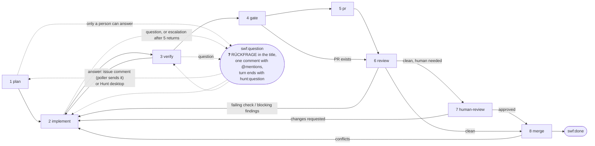

# Software factory: the steps of the swf pipeline

The poller (`../src/swf/poller.service.ts`) turns a GitHub issue labelled `swf` into a merged pull request. This folder
holds the prompts of the steps, numbered in their order; the poller compiles them in verbatim (`?raw` imports in
`../src/swf/swf.main.ts`), so each file holds nothing but its prompt. `{{placeholders}}` are filled by `fillPrompt`
(`libs/domain/src/shared/prompts.utils.ts`) in `../src/swf/swf-prompts.utils.ts`, which throws on a placeholder without
a value. The pipeline itself (record, transitions, the poller's own steps) is `../src/swf/pipeline.domain.ts`; the step
names are `libs/domain/src/swf/swf-step.types.ts`, the result marker `step-result.utils.ts` beside it.

## The steps

Steps 1 to 5 are the agent's: one Claude Code turn each on the session VM, started by the step's prompt and ended with
a **step result**, a comment on the issue that carries `<!-- hunt:step {…} -->`. Steps 6 to 8 are the poller's: it
watches the pull request on GitHub, no prompt is sent.

| # | Step | Label | Prompt | What happens | Result |
| --- | --- | --- | --- | --- | --- |
| 0 | — | — | `0-system-prompt.md` | appended to the session's system prompt at its start: the protocol of the steps (how a step ends, questions to the people, giving up, the guardrails) | — |
| 1 | `plan` | `swf:plan` | `1-plan.user-prompt.md` (the first prompt, with the issue and all its comments) | invoke the step's skill (`swf.skills.plan` of hunt.json); read the issue and the repository's guardrails; ask every question only a person can answer; comment the plan with the acceptance criteria | `{"step":"plan"}` |
| 2 | `implement` | `swf:implement` | `2-implement.user-prompt.md` with the findings to fix; `2-implement-escalate.user-prompt.md` after more than `MAX_ATTEMPTS` (5) returns | invoke the step's skill (`swf.skills.implement` of hunt.json); carry out the plan or fix the findings; run the repository's checks; commit and push | `{"step":"implement","summary":"…"}` |
| 3 | `verify` | `swf:verify` | `3-verify.user-prompt.md` | invoke the step's skill (`swf.skills.verify` of hunt.json); run hunt.json's `checks` and the repository's; verify every acceptance criterion, in the browser for anything the user sees; read the diff as a reviewer; fix nothing | `{"step":"verify","findings":[…]}`; findings → back to 2 |
| 4 | `gate` | `swf:gate` | `4-gate.user-prompt.md` | a subagent with a fresh context judges from the diff, the issue and the repository's rubric (the step's skill, `swf.skills.gate` of hunt.json) whether a person has to review before the merge | `{"step":"gate","humanReview":bool,"risk":"low\|medium\|high","reasons":[…]}` |
| 5 | `pr` | `swf:pr` | `5-pr.user-prompt.md` (first pass only) | invoke the step's skill (`swf.skills.pr` of hunt.json); open the pull request (`Closes #n`, decisions, how it was checked), comment the link, clean the VM up | `{"step":"pr","pullRequest":n}` |
| 6 | `review` | `swf:review` | — | wait for the head commit's checks and the Claude review's verdict (`<!-- claude-pr-review:verdict {"headSha","blocking","findings"} -->`); a failing check or blocking findings → back to 2 | both clean |
| 7 | `human-review` | `swf:human-review` | — | only when the gate (or `swf.humanReviewPaths`) asked for a person: label the pull request `hunt:human-review`, request the issue's assignees as reviewers, mention them once; wait for an approval; a change request → back to 2 | a person's approval |
| 8 | `merge` | `swf:merge` | — | update the branch when it is behind, squash-merge when GitHub reports it mergeable; conflicts → back to 2 | `swf:done`, project status `Done` |

Every return to 2 counts as an attempt and runs 3, 4 and 6 again before the pull request is reviewed once more.
`humanReview` stays true once set. On the first pass the issue moves to `In Review` in its projects when the pull
request opens, and when a person has to review, that person is asked at that moment.

**Questions** are possible in every agent step and happen before the step's result: the agent replaces the step's
label with `swf:question`, puts `❓ RÜCKFRAGE: ` (German) or `❓ QUESTION: ` in front of the issue's title, comments
every question at once with a mention of the issue's assignees (or its author) and ends its turn with
`<!-- hunt:question -->`. The poller sends no prompt while the label stands. An answer as a comment on the issue goes to
the agent with `answer.user-prompt.md` (a stopped VM is started first); an answer given in a Hunt desktop needs no
poller. The agent puts the step's label back, takes the mark off the title and finishes the step, so a question in
step 1 ends with the plan comment as if nothing had interrupted it; the plan never mentions the questions or answers.
An answer that leaves a question open is asked again.

## Step skills

Every agent step has a Claude Code skill that the repository keeps (`.claude/skills/<name>/SKILL.md`) and names under
`swf.skills` of its hunt.json by the step (`"skills": {"plan": "swf-plan", "implement": "swf-implement", "verify": "swf-verify",
"gate": "swf-gate", "pr": "swf-pr"}`; `AGENT_STEPS` in `libs/domain/src/swf/swf-step.types.ts`). Hunt has no default skill
and no fallback prompt for a missing one: for a repository with a `swf` section, `hunt-ctl session-config` fails with a
problem per step `swf.skills` leaves out (`swf.skills.<step>: must name the skill of the step …`) and per skill file the
worktree lacks (`swf.skills.<step>: no skill file …`), and reports the skill of every step as `swf_skills`; the poller
fails the setup itself when the answer names no skill for a step (`missingSkillsError` in `swf-comments.utils.ts`). The
client asks once, when a session of the repository opens, whether to add the missing entries (`swf-<step>`) to hunt.json
and to create the missing skill files from its templates (`apps/client/prompts/swf-<step>.skill.md`). The poller keeps the
skills in the record (`skills`; a record without the skill of every step is unusable) and fills each step's prompt with
its skill as `{{skill}}`: the prompts of plan, implement, verify and pr tell the agent
to invoke the skill first; the gate prompt hands it to the judging subagent, which reads the repository's rubric for the
review necessity from the skill file.
Hunt's prompts fix what a step delivers (its result, labels and questions; "Step skills" in `0-system-prompt.md` says
the prompt wins over a skill there); a skill adds what the repository needs in the step: which files to read, which
services to start, which checks to run, how its pull requests are written.

## Prompts outside the steps

| File | When | Where it lands |
| --- | --- | --- |
| `nudge.user-prompt.md` | a poll finds the agent's turn ended while the issue is still at an agent step with no result; once per step, never while a Hunt desktop is connected | reminds the agent to post the step's result, ask with the question label or give up; when the next turn ends the same way, the poller marks the issue as failed |
| `answer.user-prompt.md` | a poll finds a comment by someone other than the app's bot user after the agent's question while the issue is labelled `swf:question`; each answer once, never while the relay is busy or a desktop is connected; a stopped VM is started first | brings the answers and tells the agent to take the label back to the step and finish it |
| `bad-result.user-prompt.md` | a poll finds a step result the poller cannot use (malformed, or the result of another step than the current one); once the relay is idle and no desktop is connected | tells the agent why (`{{problem}}`) and to post the step's result again, without the file's final line break; the pipeline stays at its step |

## Placeholders

The prompts of the steps, `nudge.user-prompt.md` and `answer.user-prompt.md` may use the issue (`number`, `repo`), the
labels of the workflow (`requested`, `question`, `done`, `failed`, the current `step` and its `stepLabel`) and the `gh issue edit` commands that move between them
(`relabelQuestion`, `relabelResume`, `relabelFailed`; `labelValues` in `swf/swf-prompts.utils.ts`); the prompts append `--title` to
the question and resume commands, which put a red question mark and the word for a question back in front of the
issue's title and take it off again. `branch` is the session's branch, `maxAttempts` the limit of returns to implement
and `attemptNote` the ` (attempt n of m)` suffix of a return, empty for the first implementation. The plan prompt also
gets `title`, `url`, `author`, `createdAt`, `body` and `comments`; implement gets `findings`; gate gets `pullRequest`;
pr gets `humanReview`; every agent step's prompt gets `skill`, the name of the step's skill (`skillOf` of the
pipeline). `bad-result.user-prompt.md` gets only `problem`.

## What the repository provides

`hunt.json` (`swf.model`, `swf.humanReviewPaths`, `swf.skills`, `checks`), the skill of every agent step (named under
`swf.skills`; the gate's holds the rubric for the review necessity), its guardrails (CLAUDE.md, rules, skills, ADRs, pull request
template), an issue form with acceptance criteria, a Claude review workflow that runs on every push and ends its
comment with the verdict marker, and a required check `review-gate` that passes a pull request of the bot without
`hunt:human-review` and every other one only with a person's approval. app-framework is the reference. The GitHub App
needs `Checks: read` for step 6.
