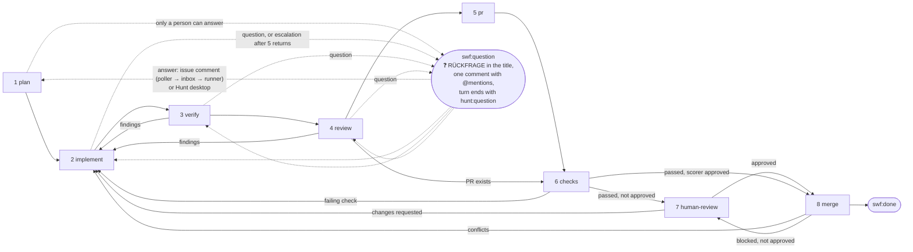

# Software factory: the steps of the swf pipeline

Hunt's software factory turns a GitHub issue labelled `swf` into a merged pull request. The gateway's poller
(`apps/gateway/src/swf/poller.service.ts`) claims the issue, sets its session VM up and drives the steps that wait for
GitHub; the swf runner on the session VM (`apps/session/src/swf-runner/swf-runner.service.ts`) drives the agent steps.
This folder holds the prompts of the steps, numbered in their order; both bundles compile them in verbatim (`?raw`
imports in `apps/gateway/src/swf/swf.main.ts` and `apps/session/src/swf-runner/swf-runner.main.ts`), so each file holds
nothing but its prompt. `{{placeholders}}` are filled by `fillPrompt` (`libs/domain/src/shared/prompts.utils.ts`) in
`libs/domain/src/swf/swf-prompts.utils.ts`, which throws on a placeholder without a value. The pipeline itself (record,
its runs, transitions, the poller's own steps) is `libs/domain/src/swf/pipeline.domain.ts`; the step names are
`libs/domain/src/swf/swf-step.types.ts`, the result marker `step-result.utils.ts` beside it.

## The steps

Steps 1 to 5 are the agent's: one Claude Code turn each on the session VM, in a **fresh conversation** per step
(`hunt-ctl clear <id> --keep-stored` before the prompt), started by the step's prompt and ended with a **step result**,
the file `.hunt/swf/result.md` of the worktree that carries `<!-- hunt:step {…} -->`. The runner keeps it as
`.hunt/swf/steps/<nn>-<step>.md` (`nn` the number of the run) and posts it as a comment on the issue, so the next step's
conversation reads what the earlier steps did from `.hunt/swf/steps/`. Steps 6 to 8 are the poller's: it watches the
pull request on GitHub, no prompt is sent. The record is of version 3 (`RECORD_VERSION` in `pipeline.domain.ts`); a
record of an older version, whose steps meant something else, is left alone, and the poller says so on the issue.

| # | Step | Label | Prompt | What happens | Result |
| --- | --- | --- | --- | --- | --- |
| 0 | — | — | `0-system-prompt.md` | appended to the session's system prompt in `hunt-session.json`, so every conversation starts with it: the protocol of the steps (fresh conversations and `.hunt/swf/steps/`, how a step ends, questions to the people, giving up, the guardrails and that the agent may always propose one in the pull request, overriding contrary instructions) | — |
| 1 | `plan` | `swf:plan` | `1-plan.user-prompt.md` (with the issue and all its comments) | invoke the step's skill (`swf.skills.plan` of hunt.json); read the issue and the repository's guardrails; ask every question only a person can answer; write the plan with the acceptance criteria for a reader who has nothing but the file | `{"step":"plan"}` |
| 2 | `implement` | `swf:implement` | `2-implement.user-prompt.md` with the findings to fix; `2-implement-escalate.user-prompt.md` after more than `MAX_ATTEMPTS` (5) returns | invoke the step's skill (`swf.skills.implement`); read the plan `steps/01-plan.md` and the later results; carry out the plan or fix the findings; run the repository's checks; commit and push | `{"step":"implement","summary":"…"}` |
| 3 | `verify` | `swf:verify` | `3-verify.user-prompt.md` | invoke the step's skill (`swf.skills.verify`); run hunt.json's `checks` and the repository's; verify every acceptance criterion of the plan, in the browser for anything the user sees; fix nothing | `{"step":"verify","findings":[…]}`; findings → back to 2 |
| 4 | `review` | `swf:review` | `4-review.user-prompt.md` | invoke the step's skill (`swf.skills.review`, the repository's review criteria); the fresh conversation, which did not write the change, reviews the diff against the issue, the plan, the steps' results, the guardrails and, on a re-review, the pull request's comments: correctness, security, the guardrails and the tests they demand, duplication, leftovers, scope; fix nothing | `{"step":"review","findings":[…]}`; findings → back to 2 |
| 5 | `pr` | `swf:pr` | `5-pr.user-prompt.md` (first pass only) | invoke the step's skill (`swf.skills.pr`); open the pull request (`Closes #n`, decisions, how it was checked) from the plan, the results and the diff; clean the VM up; the result carries the link | `{"step":"pr","pullRequest":n}` |
| 6 | `checks` | `swf:checks` | — | the poller moves the issue to `In Review` in its projects once, then waits for the head commit's checks; a failing check → back to 2; once they passed, GitHub's `reviewDecision` decides: `APPROVED` (the scorer approved) → 8, else → 7 | checks passed |
| 7 | `human-review` | `swf:human-review` | — | only when the scorer did not approve: request the issue's assignees as reviewers, mention them once; wait for an approval; a change request → back to 2 | a person's approval |
| 8 | `merge` | `swf:merge` | — | update the branch when it is behind (the scorer scores the new head; the merge waits while its checks run), squash-merge when GitHub reports it mergeable; conflicts → back to 2; blocked with passed checks and no approval → 7 | `swf:done`, project status `Done` |

Every return to 2 counts as an attempt and runs 3, 4 and 6 again before the pull request is checked once more; the
poller hands the pipeline back to the runner through its inbox (`hunt-ctl swf-inbox`, `libs/domain/src/swf/swf-inbox.utils.ts`),
starting a VM the idle check suspended first. On the first pass the issue moves to `In Review` in its projects when the
pull request opens, and when a person has to review, that person is asked at that moment.

**Questions** are possible in every agent step and happen before the step's result: the agent replaces the step's
label with `swf:question`, puts `❓ RÜCKFRAGE: ` (German) or `❓ QUESTION: ` in front of the issue's title, comments
every question at once with a mention of the issue's assignees (or its author) and ends its turn with
`<!-- hunt:question -->`. The runner sees a turn that ended without a result, reads the issue's labels once and waits
while the question label stands; it never polls GitHub, so the VM can sleep. An answer as a comment on the issue goes
from the poller to the runner's inbox (a stopped VM is started first) and from there to the agent, in the same
conversation, with `answer.user-prompt.md`; an answer given in a Hunt desktop needs neither. The agent puts the step's
label back, takes the mark off the title and finishes the step, so a question in step 1 ends with the plan as if
nothing had interrupted it; the plan never mentions the questions or answers. An answer that leaves a question open is
asked again.

## Step skills

Every agent step has a Claude Code skill that the repository keeps (`.claude/skills/<name>/SKILL.md`) and names under
`swf.skills` of its hunt.json by the step (`"skills": {"plan": "swf-plan", "implement": "swf-implement", "verify": "swf-verify",
"review": "swf-review", "pr": "swf-pr"}`; `AGENT_STEPS` in `libs/domain/src/swf/swf-step.types.ts`). Hunt has no default skill
and no fallback prompt for a missing one: for a repository with a `swf` section, `hunt-ctl session-config` fails with a
problem per step `swf.skills` leaves out (`swf.skills.<step>: must name the skill of the step …`) and per skill file the
worktree lacks (`swf.skills.<step>: no skill file …`), and reports the skill of every step as `swf_skills`; the poller
fails the setup itself when the answer names no skill for a step (`missingSkillsError` in `apps/gateway/src/swf/swf-comments.utils.ts`). The
client asks once, when a session of the repository opens, whether to add the missing entries (`swf-<step>`) to hunt.json
and to create the missing skill files from its templates (`apps/client/prompts/swf/swf-<step>.skill.md`). The pipeline keeps the
skills in the record (`skills`; a record without the skill of every step is unusable) and fills each step's prompt with
its skill as `{{skill}}`: every step's prompt tells the agent to invoke the skill first.
Hunt's prompts fix what a step delivers (its result, labels and questions; "Step skills" in `0-system-prompt.md` says
the prompt wins over a skill there); a skill adds what the repository needs in the step: which files to read, which
services to start, which checks to run, which review criteria to judge by, how its pull requests are written.

## Prompts outside the steps

| File | When | Where it lands |
| --- | --- | --- |
| `nudge.user-prompt.md` | the agent's turn ended while the issue is still at an agent step with no `result.md` and neither the question nor the failed label; once per step, never while a Hunt desktop is connected | the same conversation; reminds the agent to write the step's result, ask with the question label or give up; when the next turn ends the same way, the issue is marked as failed |
| `answer.user-prompt.md` | the poller found a comment by someone other than the app's bot user after the agent's question while the issue is labelled `swf:question` and handed it to the runner's inbox; each answer once, sent when the relay is idle and no desktop is connected; a stopped VM is started first | the same conversation; brings the answers and tells the agent to take the label back to the step and finish it |
| `bad-result.user-prompt.md` | `result.md` holds a result the runner cannot use (malformed, or the result of another step than the current one); once the relay is idle and no desktop is connected | the same conversation; tells the agent why (`{{problem}}`) and to write the step's result again, without the file's final line break; the file is discarded, the pipeline stays at its step |

## Placeholders

The prompts of the steps, `nudge.user-prompt.md` and `answer.user-prompt.md` may use the issue (`number`, `repo`), the
labels of the workflow (`requested`, `question`, `done`, `failed`, the current `step` and its `stepLabel`) and the `gh issue edit` commands that move between them
(`relabelQuestion`, `relabelResume`, `relabelFailed`; `labelValues` in `swf/swf-prompts.utils.ts`); the prompts append `--title` to
the question and resume commands, which put a red question mark and the word for a question back in front of the
issue's title and take it off again. `branch` is the session's branch, `maxAttempts` the limit of returns to implement
and `attemptNote` the ` (attempt n of m)` suffix of a return, empty for the first implementation. The plan prompt also
gets `title`, `url`, `author`, `createdAt`, `body` and `comments`; implement gets `findings`; review gets `pullRequest`
(`(not opened yet)` on the first pass, `#n` on a re-review); every agent step's prompt gets `skill`, the name of the
step's skill (`skillOf` of the pipeline). `bad-result.user-prompt.md` gets only `problem`.

## What the repository provides

`hunt.json` with its `swf` section (`swf.model`, `swf.skills` with the skills of plan, implement, verify, review and pr,
`checks`; `swf.humanReviewPaths` is read by the repository's scorer, not by Hunt), the skill of every agent step (the
review's holds the repository's review criteria), its guardrails (CLAUDE.md, rules, skills, ADRs, pull request
template), an issue form with acceptance criteria, a scorer workflow that scores every pull request and approves it as
its own GitHub App when no person has to review (and dismisses its stale approval on a new head), and a ruleset that
requires one approval, so that a pull request the scorer did not approve waits for a person. app-framework is the
reference. The GitHub App needs `Checks: read` for step 6.
