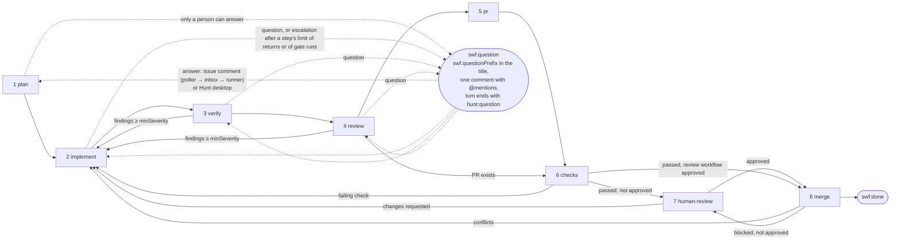

# Software factory: the steps of the swf pipeline

Hunt's software factory turns a GitHub issue labelled `swf` into a merged pull request. The gateway's poller
(`apps/gateway/src/swf/poller.service.ts`) claims the issue, sets its session VM up and drives the steps that wait for
GitHub; the swf runner on the session VM (`apps/session/src/swf-runner/swf-runner.service.ts`) drives the agent steps.
This folder holds the prompts of the steps, numbered in their order; both bundles compile them in verbatim (`?raw`
imports in `apps/gateway/src/swf/swf.main.ts` and `apps/session/src/swf-runner/swf-runner.main.ts`), so each file holds
nothing but its prompt. `{{placeholders}}` are filled by `fillPrompt` (`libs/domain/src/shared/prompts.utils.ts`) in
`libs/domain/src/swf/swf-prompts.utils.ts`, which throws on a placeholder without a value. The pipeline itself (record,
its runs, transitions, the poller's own steps) is `libs/domain/src/swf/pipeline.domain.ts`; the step names are
`libs/domain/src/swf/swf-step.types.ts`, the result marker `step-result.utils.ts` beside it.

## The steps

Steps 1 to 5 are the agent's: one Claude Code turn each on the session VM, in a **fresh conversation** per step
(`hunt-ctl clear <id> --keep-stored` before the prompt), started by the step's prompt and ended with a **step result**,
the file `.hunt/swf/result.md` of the worktree that carries `<!-- hunt:step {…} -->`. The runner keeps it as
`.hunt/swf/steps/<nn>-<step>.md` (`nn` the number of the run) and posts it as a comment on the issue, so the next step's
conversation reads what the earlier steps did from `.hunt/swf/steps/`. Steps 6 to 8 are the poller's: it watches the
pull request on GitHub, no prompt is sent. The record is of version 4 (`RECORD_VERSION` in `pipeline.domain.ts`); a
record of an older version, whose fields meant something else, is left alone, and the poller says so on the issue.

An agent step whose settings name a **gate** is finished only when the gate is green: once the agent wrote
`.hunt/swf/result.md`, the runner runs the gate's checks of hunt.json and checks that the working tree is clean; a red
check or a dirty tree goes back to the agent in the same conversation with `gate-failed.user-prompt.md`
(`noteGateFailure`, `gateRuns` in the record). A gate failure is no return. After `maxGateRuns` failures of the step's
result the next one brings `gate-escalate.user-prompt.md` instead, which asks the agent to ask the people. Implement's
gate is every check of hunt.json unless the repository names another; the other steps have none unless it names one.

| # | Step | Label | Prompt | What happens | Result |
| --- | --- | --- | --- | --- | --- |
| 0 | — | — | `0-system-prompt.md` | appended to the session's system prompt in `hunt-session.json`, so every conversation starts with it: the protocol of the steps (fresh conversations and `.hunt/swf/steps/`, the limits of returns, how a step ends and its gate, questions to the people, giving up, the guardrails and that the agent may always propose one in the pull request, overriding contrary instructions) | — |
| 1 | `plan` | `swf:plan` | `1-plan.user-prompt.md` (with the issue and all its comments) | invoke the step's skill (`swf.steps.plan.skill` of hunt.json); read the issue and the repository's guardrails; ask every question only a person can answer; create and push the session's branch by the repository's branch naming rules (the worktree is a checkout of the default branch); write the plan with the acceptance criteria for a reader who has nothing but the file | `{"step":"plan","branch":"…"}`; Hunt checks that the worktree is on the branch and records it |
| 2 | `implement` | `swf:implement` | `2-implement.user-prompt.md` with the findings to fix and, after a return, which step sent it back how often of its limit; `2-implement-escalate.user-prompt.md` once a step sent it back more often than its `maxReturns` | invoke the step's skill; read the plan `steps/01-plan.md` and the later results; carry out the plan or fix the findings; run the gate's checks and the repository's; commit and push; the gate (every check by default) must pass | `{"step":"implement","summary":"…"}` |
| 3 | `verify` | `swf:verify` | `3-verify.user-prompt.md` | invoke the step's skill; verify every acceptance criterion of the plan, in the browser for anything the user sees, running a check of hunt.json only where a criterion needs its output (implement's gate ran them); fix nothing | `{"step":"verify","findings":[{"text","severity"}, …]}`; findings at or above `minSeverity` (3) → back to 2, at most `maxReturns` (5) times; the others stay in the result as suggestions |
| 4 | `review` | `swf:review` | `4-review.user-prompt.md` | invoke the step's skill (the repository's review criteria); the fresh conversation, which did not write the change, reviews the diff against the issue, the plan, the steps' results, the guardrails and, on a re-review, the pull request's comments: correctness, security, the guardrails and the tests they demand, duplication, leftovers, scope; fix nothing | `{"step":"review","findings":[{"text","severity"}, …]}`; findings at or above `minSeverity` (3) → back to 2, at most `maxReturns` (3) times; the others stay in the result as suggestions |
| 5 | `pr` | `swf:pr` | `5-pr.user-prompt.md` (first pass only) | invoke the step's skill; open the pull request (`Closes #n`, decisions, how it was checked) from the plan, the results and the diff; clean the VM up; the result carries the link | `{"step":"pr","pullRequest":n}` |
| 6 | `checks` | `swf:checks` | — | the poller moves the issue to the `inReview` status of `swf.projectStatus` (`In Review`) in its projects once, then waits for the head commit's checks; a failing check → back to 2, at most `maxReturns` (2) times; once they passed, GitHub's `reviewDecision` decides: `APPROVED` (the repository's review workflow approved) → 8, else → 7 | checks passed |
| 7 | `human-review` | `swf:human-review` | — | only when the repository's review workflow did not approve: request the issue's assignees as reviewers, mention them once; wait for an approval; a change request → back to 2, at most `maxReturns` (3) times | a person's approval |
| 8 | `merge` | `swf:merge` | — | update the branch when it is behind (the repository's review workflow reviews the new head; the merge waits while its checks run), merge with `swf.mergeMethod` (`squash`) when GitHub reports it mergeable; conflicts → back to 2, at most `maxReturns` (2) times; blocked with passed checks and no approval → 7 | `swf:done`, the `done` status of `swf.projectStatus` (`Done`) |

Every return to 2 counts for the step that sent the issue back (`returns` in the record) and runs 3, 4 and 6 again
before the pull request is checked once more. Each returning step has its own limit (`maxReturns`; Hunt's defaults are
`DEFAULT_MAX_RETURNS` in `libs/domain/src/swf/step-settings.value-object.ts`: verify 5, review 3, checks 2,
human-review 3, merge 2): the return past it makes the implement step an escalation, the agent asks the people, and that
step counts anew; the plan's result starts every count anew. A finding of verify or review carries a severity of 1 to 5
(`Finding` in `step-result.utils.ts`; the scale is in the review prompt): only a finding at or above the step's
`minSeverity` (`swf.steps.<step>.minSeverity` of hunt.json, `DEFAULT_MIN_SEVERITY` 3 without it) returns, gravest first
and with its severity in the implement prompt (`Review (severity 4): …`); a finding written as a plain string carries no
severity and always returns; the others stay in the step result as suggestions, which the pr step carries into the pull
request. The poller hands the pipeline back to the runner through its inbox (`hunt-ctl swf-inbox`, `libs/domain/src/swf/swf-inbox.utils.ts`),
starting a VM the idle check suspended first. On the first pass the issue moves to the `inReview` status in its projects
when the pull request opens, and when a person has to review, that person is asked at that moment.

**Questions** are possible in every agent step and happen before the step's result: the agent replaces the step's
label with `swf:question`, puts the repository's `swf.questionPrefix` and a colon (`❓ RÜCKFRAGE: ` by default) in
front of the issue's title, comments every question at once, starting with the prefix in bold, with a mention of the
issue's assignees (or its author) and ends its turn with `<!-- hunt:question -->`. The runner sees a turn that ended
without a result, reads the issue's labels once and waits while the question label stands; it never polls GitHub, so the VM can sleep. An answer as a comment on the issue goes
from the poller to the runner's inbox (a stopped VM is started first) and from there to the agent, in the same
conversation, with `answer.user-prompt.md`; an answer given in a Hunt desktop needs neither. The agent puts the step's
label back, takes the mark off the title and finishes the step, so a question in step 1 ends with the plan as if
nothing had interrupted it; the plan never mentions the questions or answers. An answer that leaves a question open is
asked again.

## Step settings

The `swf` section of hunt.json sets each step under `swf.steps.<step>` (`SWF_STEPS` in
`libs/domain/src/swf/swf-step.types.ts`):

- `skill`: every agent step's Claude Code skill, which the repository keeps in `.claude/skills/<name>/SKILL.md`;
  `swf.skills.<step>` is an alias. Hunt has no default skill and no fallback prompt for a missing one.
- `model`, `effort`: an agent step's config options of Claude Code, else the section's `swf.model` and `swf.effort`,
  else Claude Code's defaults.
- `maxReturns`: a returning step's limit of returns (verify, review, checks, human-review, merge), else Hunt's default.
- `checks`: the checks of hunt.json's `checks` an agent step's result must pass (its gate), `"*"` for every check; without one,
  implement's gate is every check and the other steps have none.

`swf.maxGateRuns` limits the gate failures of one step result (Hunt's default `DEFAULT_MAX_GATE_RUNS`, 5).
`apps/session/src/session-config/swf-settings.value-object.ts` resolves the defaults; for a repository with a `swf`
section, `hunt-ctl session-config` fails with a problem per agent step without a skill and per skill file the worktree
lacks, and reports the resolved settings as `swf_steps` (`StepSettings` in
`libs/domain/src/swf/step-settings.value-object.ts`); the poller parses them with `stepSettings` of
`pipeline.domain.ts` and fails the setup itself when they name no skill for a step. The client asks once, when a session
of the repository opens, whether to add the missing entries (`swf-<step>`) to hunt.json and to create the missing skill
files from its templates (`apps/client/prompts/swf/swf-<step>.skill.md`). The pipeline keeps the settings in the record
(`settings`; a record without usable settings is unusable): it fills each step's prompt with its skill as `{{skill}}`,
starts each step's conversation with its config options (`configOptionsOf`), counts the returns against `maxReturns`
and runs the gate (`gateOf`). Every step's prompt tells the agent to invoke the skill first.
Hunt's prompts fix what a step delivers (its result, labels and questions; "Step skills" in `0-system-prompt.md` says
the prompt wins over a skill there); a skill adds what the repository needs in the step: which files to read, which
services to start, which checks to run, which review criteria to judge by, how its pull requests are written.

## Prompts outside the steps

| File | When | Where it lands |
| --- | --- | --- |
| `nudge.user-prompt.md` | the agent's turn ended while the issue is still at an agent step with no `result.md` and neither the question nor the failed label; once per step | the same conversation; reminds the agent to write the step's result, ask with the question label or give up; when the next turn ends the same way, the issue is marked as failed |
| `answer.user-prompt.md` | the poller found a comment by someone other than the app's bot user after the agent's question while the issue is labelled `swf:question` and handed it to the runner's inbox; each answer once, sent when the relay is idle; a stopped VM is started first | the same conversation; brings the answers and tells the agent to take the label back to the step and finish it |
| `bad-result.user-prompt.md` | `result.md` holds a result the runner cannot use (malformed, or the result of another step than the current one); once the relay is idle | the same conversation; tells the agent why (`{{problem}}`) and to write the step's result again, without the file's final line break; the file is discarded, the pipeline stays at its step |
| `gate-failed.user-prompt.md` | a usable result of an agent step failed the step's gate: a check of the gate failed or the working tree is not clean; up to `maxGateRuns` times per result | the same conversation; quotes the failed checks with the end of their output and the dirty files, and tells the agent to fix them, commit, push and write the result again; the pipeline stays at its step and counts the gate run, no return |
| `gate-escalate.user-prompt.md` | the step's result failed its gate more than `maxGateRuns` times | the same conversation; tells the agent to stop fixing and ask the people with the question label, naming what fails and what it tried |

## Placeholders

The prompts of the steps, `nudge.user-prompt.md` and `answer.user-prompt.md` may use the issue (`number`, `repo`), the
labels of the workflow (`requested`, `question`, `done`, `failed`, the current `step` and its `stepLabel`) and the `gh issue edit` commands that move between them
(`relabelQuestion`, `relabelResume`, `relabelFailed`; `labelValues` in `swf/swf-prompts.utils.ts`); the prompts append `--title` to
the question and resume commands, which put a red question mark and the word for a question back in front of the
issue's title and take it off again; `questionPrefix` is the repository's `swf.questionPrefix`. `branch` is the
session's branch, which the plan step created and reported, so the prompts of the later steps get it. The plan prompt
also gets `title`, `url`, `author`, `createdAt`, `body` and `comments`; implement gets `findings` and `attemptNote`, the
` (return n of m, sent back by <step>)` suffix of a return (`causeOf` of the pipeline), empty for the first
implementation; the escalation gets `findings`, `causeStep` (the step that sent the change back, in backticks) and
`maxReturns` (its limit); review gets `pullRequest` (`(not opened yet)` on the first pass, `#n` on a re-review); every
agent step's prompt gets `skill`, the name of the step's skill (`skillOf` of the pipeline). The two gate prompts get the
labels and commands of the step as well, `failures` (per failed check `### <name> (exit <code>)` and the last 80 lines
of its output in a fence, then `### working tree not clean after the checks` with the dirty files), `gateRuns` and
`maxGateRuns`. `bad-result.user-prompt.md` gets only `problem`.

## What the repository provides

`hunt.json` with its `swf` section (`swf.steps.<step>` with the skill of plan, implement, verify, review and pr and
optionally their `model`, `effort`, `maxReturns` and `checks`, the alias `swf.skills`, `swf.model`, `swf.effort`,
`swf.maxGateRuns`; `swf.questionPrefix`, the prefix of the title of an issue with an open question, `swf.projectStatus`,
the names of the Status options the poller sets in the issue's projects (`inProgress`, `inReview`, `done`), and
`swf.mergeMethod`, how the poller merges (`squash`, `merge` or `rebase`); `swf.humanReviewPaths` is read by the
repository's review workflow, not by Hunt) and its `checks`, which the gates run, the skill of every agent step (the
review's holds the repository's review criteria; the plan's states the branch naming rules, since the plan step creates
the session's branch and Hunt names none), its guardrails (CLAUDE.md, rules, skills, ADRs, pull request
template), an issue form with acceptance criteria, a review workflow (such as a scoring GitHub Action) that reviews
every pull request and approves it as its own GitHub App when no person has to review (and dismisses its stale approval
on a new head), and a ruleset that requires one approval, so that a pull request the workflow did not approve waits
for a person. app-framework is the reference. The GitHub App needs `Checks: read` for step 6.
